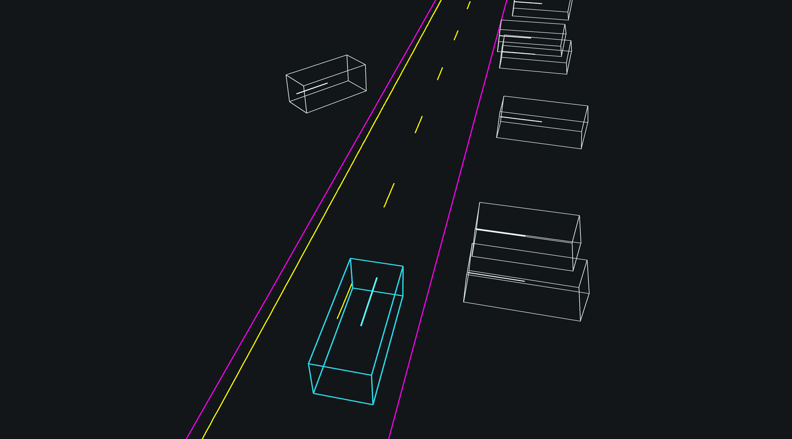

<!-- SPDX-FileCopyrightText: Copyright (c) 2026 FlashDreams contributors -->
<!-- SPDX-License-Identifier: Apache-2.0 -->

FlashDreams Interactive Drive 在单机单 GPU 上提供两种 ROS 2 Humble 控制方式。算法用 `/sim/step` 精确推进一块，驾驶员用 `/joy` 手柄话题连续驾驶。每次启动 bridge 选一种控制源。两种方式都按仿真采样时间返回相机和车辆状态，车辆积分步长独立于推理和输入的墙钟频率。模型进程与 Humble 节点分别使用各自的 Python 环境。

Pro6000 上的服务命令和端口转发步骤见[启动与关闭](interactive_drive_ros2_startup.md)。

## 六相机驾驶工作台

在 Foxglove 导入 `ros2/examples/jlu_wireframe_layout.json`。上排是左前、前、右前，下排是左后、后、右后，中央 3D 跟随自车。左栏可切换远程操纵、车辆状态、手柄收包、日志和频率。礁标中打开「远程操纵 → 手柄模式」进行驾驶。标准 Foxglove 客户端的 Teleop 提供方向键，接收手柄数据可用「手柄输入」页观察 `/joy`。模型和 CPU 动力学共用的简版布局是 `ros2/examples/vehicle_dynamics_layout.json`。

### 运行事件和话题频率

| 出口 | 内容 | 发布时机 |
| --- | --- | --- |
| `/rosout` · `rcl_interfaces/msg/Log` | ROS 节点、网关及本机模型服务的事件。用组件名筛选 `flashdreams_bridge`、`foxglove_bridge` 或 `flashdreams-ros-model.service`。 | 连接、场景加载、首帧和错误随事件发布。每块耗时可在 bridge 的 DEBUG 日志查看。 |
| `/diagnostics` · `diagnostic_msgs/msg/DiagnosticArray` | `flashdreams/drive` 报告当前回合、等待或执行阶段、手柄输入年龄与最近一步墙钟耗时。每台相机有一项，报告完整采样数、最新源时间、墙钟发布率、仿真采样率及实时倍率。 | 墙钟每秒一次，推理中和等待输入时也会更新。 |
| `/sim/ego/vehicle_state` · `flashdreams_interfaces/msg/VehicleState` | 前轮转角（rad）、有符号车速（m/s）、P/R/N/D 档位、油门和制动。 | 每个有效观察时刻，与里程计和图像同戳。 |

`remote_joy.launch.py` 默认从本次系统启动的用户服务 `flashdreams-ros-model.service` 转发最近 100 条 journal 记录，随后跟随新记录。保留 journal 原始时间和组件名；原生 ROS 节点直接用节点 logger。手动从终端运行模型时可设 `model_log_unit:=""`，该进程的标准输出留在启动终端。运行 `ros2 topic echo /rosout` 和 `ros2 topic echo /diagnostics --once` 可独立检查两条通路。

### 六路相机与标定

每路相机独立发布 `/sim/camera/<id>/image_raw`、同目录的 `camera_info` 和 `calibration`。六窗可独立换源。每个样本的 RGB8 图像和 CameraInfo 使用相同的采集时间戳、光学坐标系和图像尺寸。原生 F-theta 标定与静态外参在重置时发布，支持中途连接。`selected` 另供手柄切换单屏视角。

远程布局的六个 Image 面板默认订阅各自的 `image_raw/compressed`，仍绑定同一台相机的 `camera_info`。已导入的旧布局可直接将各面板图像话题末尾改为 `/image_raw/compressed`。`remote_joy.launch.py` 启动的 `camera_preview` 节点仅为有订阅者的视角编码全分辨率 JPEG，保留采集时间戳及 optical frame。预览收发队列各保留最新一帧，支持暂停时打开和手柄 `selected` 切镜。逐帧录制可订阅原始 RGB8。以 JLU 的四个连续仿真采样实测，每组六路 832×480 图像的 ROS 序列化载荷从 7.19 MB 降至 0.263–0.266 MB（JPEG 质量 75），不含 WebSocket 和 SSH 报头。

| 上排（从左到右） | 相机 ID | 下排（从左到右） | 相机 ID |
| --- | --- | --- | --- |
| CAM_FRONT_LEFT | `camera_cross_left_120fov` | CAM_BACK_LEFT | `camera_rear_left_70fov` |
| CAM_FRONT | `camera_front_wide_120fov` | CAM_BACK | `camera_rear_tele_30fov` |
| CAM_FRONT_RIGHT | `camera_cross_right_120fov` | CAM_BACK_RIGHT | `camera_rear_right_70fov` |

JLU 生成图使用线性等距虚拟镜头。bridge 按原生 F-theta、Ludus 实际绘制尺寸和输出尺寸计算标准 `equidistant` 的 K/D/R/P，包含 ROS 像素中心换算。独立用六台相机共 294 条三维射线比对渲染器与 OpenCV 投影，最大差约 0.000044 像素。重置首张是独立导出的 PNG，当前清单缺少它的像素变换，标准 CameraInfo 以 `K[0]=0` 标识。其他无法用标准模型表示的镜头也保留原生标定。图像本身可正常查看。

块内帧可以在很短的墙钟时间内连续到达。当前配置每个稳态块产出 8 个采样，仿真时间推进 0.8 s。`sample_hz_sim` 来自相邻不同源时间，`publish_hz_wall` 取最近约 5 墙钟秒的完整帧数增量，`realtime_factor` 是同一窗口内的仿真秒数与墙钟秒数之比。订阅端收包率可在对应 Foxglove 话题旁查看。

### 核对 3D 与模型的同帧位置

上排中央可以切换「前视 RGB」和「前视 WSM」。前者显示模型生成的视频，后者显示同一次生成实际送入模型的道路和参与者条件图。在已有布局里，可添加 Image 面板，选择 `/sim/camera/camera_front_wide_120fov/condition/image_raw/compressed` 和对应的 `/sim/camera/camera_front_wide_120fov/condition/camera_info`。原始 RGB8 条件图在 `condition/image_raw`，可用于逐像素投影检查。桥为每个生成时刻保留最新条件图，以便停车时打开或切换面板。远程 JPEG 仍按订阅发送。回合开头的参考照片没有对应条件图。比较时使用图像及 `/sim/ego/odom` 的 `header.stamp`，相机投影使用该时刻位姿、同一光学坐标系及该相机的标定。

JLU 校园场景用 `--road-height-primitives 30 32` 指定已配准的地面标线。自车沿坡保持起点的 rig 离地高度，3D 车框和 WSM 渲染使用同一位姿。这个参数依赖该场景的标线编号；换场景时应检查地图定义。生成 RGB 中的车道线、车辆和背景可能与条件图偏离，几何配准以条件图为参照。

### 中央 3D 面板的线框设计

中央是一张连续的深色线框图。默认视点在自车后上方，跟随车身，车头朝屏幕上方，自车位于画面中下部，给前方道路和参与者留出空间。可旋转或缩放查看。场景内只画道路几何线和参与者轮廓，关闭文字、箭头、运动轨迹、网格和坐标轴。速度、档位和前轮转角可在车辆状态消息中查看。独立话题便于订阅，最终都叠在同一张图里。



| ROS 几何来源 | 线框画法 | 更新时机 |
| --- | --- | --- |
| `/sim/ego/markers` | 青色细线画出车身长方体的 12 条棱，内部一段同色实线表示车头。 | 随 `/sim/ego/odom` 的车辆位姿更新。 |
| `/sim/traffic/markers` | 用浅色细线画源观测的有向长方体。有可靠车头朝向的车辆沿用自车画法；其余目标只画轮廓。 | 每个观察时刻取该条件帧的有效对象，过期或重置时清除旧框。 |
| `/sim/map/prim_<id>/markers` | 每个源地图图层独立发布线段，使用该层在场景清单中的颜色，保留原线型和虚线间隔。地图线比自车框细。 | 场景装载或地图版本变化时，各层分别发布完整快照，支持中途加入。 |

**地图按层选看。** 当前 JLU 图层取自 `map.json` 的 `prim`，颜色直接读同一场景 `scene.json` 的 `palette`。每个话题使用 `visualization_msgs/msg/MarkerArray`，内部按 `LINE_LIST` 批量编码。操作员在 Foxglove 的话题列表即可单独开关每层；颜色随 ROS 消息一起发送，实时和回放沿用同一套颜色。

| 图层 | ROS 话题 | 本包线段数 | 本包 RGB |
| --- | --- | ---: | --- |
| 源图层 28 | `/sim/map/prim_28/markers` | 951 | 淡绿 `#CFFFBF` |
| 源图层 30 | `/sim/map/prim_30/markers` | 3,917 | 品红 `#FD01E8` |
| 源图层 32 | `/sim/map/prim_32/markers` | 43,929 | 黄 `#FFFF00` |
| 源图层 33 | `/sim/map/prim_33/markers` | 335 | 白 `#FFFFFF` |

本地同格式制包器将道路边界、黄标线、白标线分别映射到 30、32、33。当前 JLU 清单直接给出了编号和色表，图层 28 的语义名待源数据确认。以 `prim` 作为话题标识，便于在确认语义后补充显示名。各层采用 reliable、transient-local、深度 1；切换场景时显式清除已消失图层，防止上一张地图残留。

**朝向线的两个端点。** 设长方体几何中心为 `C`、车长为 `L`，`f` 是从车尾指向车头的单位向量。实线从 `C` 连到前端面中心 `C + (L/2)·f`，两个点都在框的半高处，线段完全位于框内。倒车、停车和原地打方向时都按车身姿态确定 `f`。用 ROS `Marker.LINE_LIST` 直接画独立线段，8 个角点给出 12 条棱，车辆再加这 1 段实线。类别、观测 ID 和状态值留在数据中。

JLU 的交通参与者位置已是框中心，渲染器将车体局部 +X 作为前向。自车的 `base_link` 对应传感器 rig 原点。已做地面配准的 JLU 场景在 reset 时给出起点估算的 rig 离地高度 `rig_ground_clearance_m`。ROS 从 rig 沿世界竖直方向下降该高度，再沿车体上轴抬高半个车高，得到自车框中心。Ludus 俯视图的水平车框使用同一离地高度和车辆尺寸。未提供该值的场景沿用零离地偏移。

固定坐标系沿用场景局部坐标 `odom`，共用 `odom → base_link → 各相机 optical frame`。跟随视角只改变观察位置，地图和参与者的姿态均在场景坐标中计算。Cosmos 适配器把已装载的 prepared scene 放在 metadata，通用 SceneBundle 的地图层为空。reset 首帧携带 prepared scene 绝对路径和清单 SHA-256。同机 bridge 按清单校验并加载地图和轨迹，逐帧协议只携带实际渲染使用的源场景微秒时间。地图、里程计与参与者使用同一个场景坐标原点。

当前 JLU 包有四组静态线、49,132 条线段，以及 1,155 个来自逐帧预测和已有修订的短时目标观测。驾驶超过 197 个源帧后，3D 视图和渲染器均取最后一个源场景帧中的有效目标，自车继续积分。[Foxglove 3D 面板的时间与 TF 约定](https://docs.foxglove.dev/docs/visualization/panels/3d)

### 实机验收

在 Pro6000 的 `ws://127.0.0.1:8765` 以新客户端重复连接，收到的四个地图快照共 49,132 条线段，逐层比对端点和 RGBA 均与 prepared scene 一致。在连续四个仿真采样（12.0 至 12.3 s）按戳收齐六路 RGB8、六条 CameraInfo、自车、交通线框、里程计和车辆状态。12.3 s 的样本有 12 个交通参与者，自车 D 档、车速 4.69 m/s；见同戳状态话题。两个接收窗口的墙钟发布率约 1.6 和 2.0 Hz。WebSocket 同时收到了六个原生相机标定、模型日志与七项诊断。在独立 ROS 域先发布最后一帧再启动网关，首个客户端、同时加入的第二个客户端和断开后重新连接的客户端，都在仿真暂停时取回同戳的 /clock、动态 TF、自车及交通框，并收齐四层地图。这组验证覆盖线上协议和 CDR 内容；布局还可在操作电脑上按需调整。

## 在本机运行

下面三个终端都从仓库根目录启动。示例使用已准备的 JLU RGB 场景和本地权重，固定 seed，从静止开始。可把场景路径改为其他与应用帧率一致的 prepared scene。先在系统 ROS 环境编译两个包，构建目录放在仓库外：

```bash
source /opt/ros/humble/setup.bash
colcon --log-base /tmp/flashdreams-ros-build/log build --base-paths ros2 \
  --build-base /tmp/flashdreams-ros-build/build --install-base /tmp/flashdreams-ros-build/install
```

**终端一**运行模型。使用单卡、六相机、稳态 8 帧块。这个示例在三次有效步进后退出；移除 `--total-model-steps 3` 即可持续服务。

```bash
source .venv/bin/activate
install -d -m 700 "${XDG_RUNTIME_DIR:-/tmp}/flashdreams-${UID}"
CUDA_VISIBLE_DEVICES=0 flashdreams-run-v2 interactive-drive-cosmos3-nano-sim-auto \
  --mode null --presentation-mode on_demand --total-model-steps 3 -- \
  --no-ui --ros-socket "${XDG_RUNTIME_DIR:-/tmp}/flashdreams-${UID}/drive.sock" \
  --scene "$PWD/artifacts/jlu-123246900/scene-rgb-campus" \
  --checkpoint "$PWD/Cosmos3-Nano-Sim-Auto" --views 6 --auxiliary-scale 0.5 \
  --fps 10 --chunk-frames 2 --compile-denoise off --denoise-steps 4 \
  --road-height-primitives 30 32 \
  --world-model-seed 0 --initial-speed-mps 0
```

**终端二**运行 bridge。**终端三**同样加载 Humble 和 overlay，使用相同的 ROS 域。等待终端一的 socket 出现后运行控制示例。

```bash
# 终端二和三各运行一次
source /opt/ros/humble/setup.bash
source /tmp/flashdreams-ros-build/install/local_setup.bash
export ROS_LOCALHOST_ONLY=1 ROS_DOMAIN_ID=96
```

```bash
# 终端二
ros2 run flashdreams_bridge bridge --ros-args -p socket_path:="${XDG_RUNTIME_DIR:-/tmp}/flashdreams-${UID}/drive.sock"
```

```bash
# 终端三
/usr/bin/python3 ros2/examples/drive_smoke.py --snapshot /tmp/flashdreams-front.png
```

示例订阅相机和里程计，执行直行加速、左转加速和制动，并重复发送第一个步号验证幂等。输出的 `sim_dt` 是车辆积分覆盖时长，`wall` 是从发出控制到收到对应观测的现实耗时。`--snapshot` 通过 Pillow 保存 ROS 收到的最后一张前视图。持续服务期间再次运行示例时，传 `--previous-episode <上一回合UUID>`。关闭模型后可用 Ctrl+C 退出 bridge。若异常退出留下旧 socket 文件，可在模型和 bridge 两端指定同一个新路径重启。

## 从礁标通过 WebSocket 遥控

Pro6000 运行 Foxglove WebSocket 网关，操作电脑通过 VS Code Remote - SSH 转发端口。礁标使用同一条 TCP 连接发布 `/joy`（`sensor_msgs/msg/Joy`，CDR 编码），也可订阅相机、里程计、TF 和仿真时钟。网关把手柄消息发布到本机 ROS 2 域，FlashDreams bridge 从 `/joy` 取控制，经 `drive.sock` 交给模型。

1. 在仿真机按上文启动模型，持续遥控时移除 `--total-model-steps 3`。一般 Humble 环境可用 `sudo apt install ros-humble-foxglove-bridge` 安装网关，随后按上文编译仓库内 ROS 包。
2. 在仿真机第二个终端，从仓库根目录运行下面的命令。它同时启动监听 `127.0.0.1:8765` 的网关和 `control_mode:=joy` 的 FlashDreams bridge。两者通过本机 DDS 通信，可保持 `ROS_LOCALHOST_ONLY=1`。

```bash
source /opt/ros/humble/setup.bash
# 本台 Pro6000 的网关装在用户缓存；系统已安装该 ROS 包时可跳过这一行
source .cache/foxglove-ros/setup.bash
source /tmp/flashdreams-ros-build/install/local_setup.bash
export ROS_LOCALHOST_ONLY=1 ROS_DOMAIN_ID=96
ros2 launch flashdreams_bridge remote_joy.launch.py address:=127.0.0.1 port:=8765
```

3. 在操作电脑上，用 VS Code Remote - SSH 连到 Pro6000，打开「端口」（Ports）面板，转发远程端口 `8765`。在同一台电脑的 Foxglove 客户端中选择 **Foxglove WebSocket**，填 `ws://127.0.0.1:8765`。使用礁标操控时，桌面版会把主机名恰为 `localhost`、`127.0.0.1` 或 `[::1]` 的连接交给内置回放引擎，任何端口都可能报「无效的本地回放地址」。该版本可试 `ws://localhost.:8765`（注意英文句点），走普通 WebSocket，再选「远程操控 → 手柄模式」。如果 VS Code 分配了其他本地端口，用面板「本地地址」显示的端口替换 URL 中的 `8765`。`40801` 是礁标页面和回放入口。礁标握手时提供 `foxglove.websocket.v1` 和 `foxglove.sdk.v1`，本机 3.6.3 网关选用后者。每次只启用一个手柄发布端。
4. 在同一 ROS 域用 `ros2 topic echo /joy --once --qos-reliability best_effort` 确认服务器收到了按键。在礁标订阅 `/sim/ego/odom` 查看模型反馈，订阅 `/sim/camera/selected/image_raw` 查看当前画面。模型启动前也可验证 WebSocket 握手与手柄收包。网关允许客户端写 `/joy`，也允许订阅 `/joy` 查看手柄的原始 `axes` 和 `buttons` 数组。其他可订阅的话题包括 `/sim/*`、`/tf`、`/tf_static`、`/clock`、`/rosout` 和 `/diagnostics`。[Foxglove Bridge 配置](https://github.com/foxglove/foxglove-sdk/blob/main/ros/src/foxglove_bridge/README.md#configuration)

旧布局若提示「多个通道通告了相同的主题 /joy」，检查每个「远程操纵」面板的方向键设置。字段「线性 X」「角速度 Z」属于 `geometry_msgs/msg/Twist`，将该模式的主题改回 `/cmd_vel`，再切到手柄模式。手柄控制通道为 `/joy`（`sensor_msgs/msg/Joy`）。保存布局并重新连接会清除本次连接的旧通道。可用 `ros2 topic info /joy --verbose` 核对类型，发布者连接时应只出现 `sensor_msgs/msg/Joy`，再用 `ros2 topic echo /joy sensor_msgs/msg/Joy --once --qos-reliability best_effort` 查看轴与按键。FlashDreams 的车辆控制只读取 Joy。[Foxglove Teleop 面板](https://docs.foxglove.dev/docs/visualization/panels/teleop)

## 平地动力学和现有试验面板

只试手柄、车辆运动和 ROS 消息时，在终端一运行 CPU 动力学服务。它从原点静止起步，调用 Interactive Drive 的车辆积分器，每次接受控制后推进 0.1 仿真秒。墙钟节奏上限约 10 Hz，手柄输入超时后暂停步进。这轮试验使用平地，不生成相机图像。终端二继续用上面的 `remote_joy.launch.py`，客户端沿用同一个 WebSocket 地址。

```bash
install -d -m 700 "${XDG_RUNTIME_DIR:-/tmp}/flashdreams-${UID}"
.venv/bin/python ros2/examples/dynamics_server.py \
  --socket "${XDG_RUNTIME_DIR:-/tmp}/flashdreams-${UID}/drive.sock"
```

保留远程操纵面板，在现有 3D 面板把固定坐标系设为 `odom`，勾选 `/sim/ego/markers`。青色空心框表示车身，框中心到前端面中心的实线表示车头。倒车时车辆沿该实线的反方向运动。相邻的「原始消息」面板选择 `/sim/ego/vehicle_state`。也可以单独导入 `ros2/examples/vehicle_dynamics_layout.json`，其中预设了自车跟随视角和状态面板。

RT 给油，左摇杆控制前轮，LT 制动。停车后用十字键下挂 R，再按 RT 倒车。用十字键上回 D，Y 重置回合并回到起点。切回相机生成模式时，先结束占用同一个 socket 的 CPU 服务。如果使用本机已启动的试验服务，运行 `systemctl --user stop flashdreams-dynamics-trial.service`，再按「终端一」的原命令启动模型。

从仓库根目录可以独立复现定量试验，包含 D 档直行、左转、刹停、R 档倒车、再刹停和 P 档驻车。脚本检查速度符号、停车时位置和转向，并把采样轨迹、前轮转角和有符号车速画在一张图上。

```bash
.venv/bin/python ros2/examples/dynamics_trial.py --plot /tmp/flashdreams-dynamics.png
```

## 用原生 ROS 手柄节点驾驶

终端一沿用上面的模型命令，移除 `--total-model-steps 3`，让模型持续等候手柄。终端二和终端三分别加载上面的 Humble、overlay 和相同的 ROS 域，然后运行：

```bash
# 终端二：从 /joy 取得驾驶输入
ros2 run flashdreams_bridge bridge --ros-args -p control_mode:=joy \
  -p socket_path:="${XDG_RUNTIME_DIR:-/tmp}/flashdreams-${UID}/drive.sock"
```

```bash
# 终端三：列出设备，再启动标准 SDL 手柄驱动
ros2 run joy joy_enumerate_devices
ros2 run joy game_controller_node --ros-args -p deadzone:=0.0 -p autorepeat_rate:=5.0
```

使用 `joy/game_controller_node` 的 SDL 标准布局。Xbox、PS 等手柄由驱动映射到相同的控件，原始 `joy_node` 的编号依设备而异。驱动用系统时间发送 `sensor_msgs/msg/Joy` 到 `/joy`，重复发送按住的状态。桥接层沿用 Web 驾驶舱的死区和转向曲线。多个手柄可为驱动指定 `-p device_id:=1` 等枚举出的编号。要改输入话题，可在 bridge 上加 `-r /joy:=/driver/joy`，并将发布端设到同一话题。[Humble 对应版本的 joy 驱动说明](https://github.com/ros-drivers/joystick_drivers/blob/3.3.0/joy/README.md)

如果手柄插在同一局域网的另一台电脑，在那台电脑运行手柄驱动，两端设相同的 `ROS_DOMAIN_ID` 和 `ROS_LOCALHOST_ONLY=0`，并确保 DDS 能互相发现。bridge 和模型仍在同一台机器上使用 Unix socket。

| 手柄控件 | SDL 的 ROS Joy 字段（从 0 起） | 仿真动作 |
| --- | --- | --- |
| 左摇杆横轴 | `axes[0]` | 左正右负，渐进转向，打满对应前轮 0.4 rad，受车型上限约束 |
| RT / LT | `axes[5]` / `axes[4]` | 油门 / 刹车。本机 Humble 驱动松开为 0，踩到底为 −1 |
| A | `buttons[0]` | 全制动，优先于油门。按住持续制动，短按也会作用到一个尚未开始的块 |
| B / X | `buttons[1]` / `buttons[2]` | 在 P、R、N、D 中升一挡 / 降一挡，初始 D |
| 十字键上 / 下 / 左 / 右 | `buttons[11..14]` | 分别直挂 D / R / P / N。P 全制动，N 松开驱动力，R 挡用 RT 倒车 |
| Y | `buttons[3]` | 重置到场景起点，正在生成的块先结束 |
| LB / RB | `buttons[9]` / `buttons[10]` | 上一个 / 下一个已启用的相机，立即显示该相机的最近图像 |

`/joy` 提供驱动上报的完整轴和按键数组。首条有效消息自动初始化回合。手柄状态变化时驱动会发消息，保持不动时按示例配置每 0.2 秒重发一次，供桥判断手柄仍在线。连续 0.75 秒墙钟没有新输入，桥会在当前块结束后暂停。重新收到有效输入时从原挡位继续。超时时间可用 `joy_timeout_s` 调整。

GPU 生成期间，桥用每条消息覆盖最新转向和踏板。假设一块耗时 2 秒，期间油门从半踩到全踩再松开，下一块只使用松开后的油门。收到的 A 强刹和 Y 重置会保留到块边界，换挡按收到的顺序更新，切镜立即生效。无论期间收到多少条输入，模型每次只推进一块。在示例的 10 Hz、稳态 4 帧配置下，每块推进 0.4 秒仿真时间。

没有手柄时，可在终端三用 ROS CLI 模拟同一输入。例如下面在 D 挡持续给半油门，Ctrl+C 停发后会触发超时暂停：

```bash
ros2 topic pub -r 5 /joy sensor_msgs/msg/Joy \
  '{axes: [0.0, 0.0, 0.0, 0.0, 0.0, -0.5], buttons: [0, 0, 0, 0, 0, 0, 0, 0, 0, 0, 0, 0, 0, 0, 0]}'
```

用 `ros2 topic echo /joy --once` 核对输入，用 `ros2 topic echo /sim/ego/odom --field twist.twist` 看纵向速度和横摆角速度。在 RViz 中添加 Image 并订阅 `/sim/camera/selected/image_raw`，LB/RB 就会切换大图。`/sim/camera/selected/camera_info` 与所选图像使用相同时间戳和真实相机的 optical frame。切镜时可能看到同一时间戳的另一台相机，可按时间戳和 frame_id 联合区分。需要算法逐块控制时，以默认 `control_mode:=step` 启动 bridge，使用下面的服务契约。

本机用 SDL 虚拟手柄、已安装的 Humble 驱动和真实 GPU 六相机场景跑过端到端验证。左打方向并踩 RT 后，里程计报纵向速度 +0.40 m/s、横摆角速度 +0.031 rad/s。短按 A 时车辆减速，踩 LT 后降至静止，十字键挂 R 后踩 RT 得到 −0.40 m/s。LB/RB 切回和切出前视相机，Y 将车辆重置为静止，断开虚拟手柄后里程计停止推进。测试时主机未连接实体手柄。

## 进程与数据所有权

```text
算法节点                           ROS 2 bridge                        FlashDreams Interactive Drive
ROS 2                              Humble / Python 3.10                 项目 Python 3.12 / GPU
   ── Reset、Step(步号和控制) ───────► │ ── Unix socket 请求 ────────────► │
                                    │                             车辆积分 → 条件轨迹 → 模型生成
   ◄── 图像、标定、odom、TF、/clock ── │ ◄── 逐帧图像、状态、源时间戳 ───── │
   ◄── Step 响应（观测区间和下一边界）─ │ ◄── 块完成 ──────────────────── │
```

- **算法节点**持有策略和传感器订阅。先订阅需要的相机与状态，再异步请求重置或步进。在服务响应和所需观测都到齐后计算下一条控制。
- **ROS bridge** 用系统 Python 运行 `rclpy`，负责 ROS 接口、时间换算、标定、TF 和消息发布。在多线程 ROS executor 中处理服务，每次只允许一个请求占用 socket，其他回调仍能响应重试或返回忙碌状态。
- **FlashDreams 进程**独占车辆状态、场景时间、后端缓存和步号。沿用 V2 的 `null` 窗口与 Interactive Drive 的 `--no-ui`。在应用侧新增可唤醒的步进等待，持有有效命令后才允许积分，在 HUD 合成前输出观测。外部控制模式由 ROS 独占驾驶输入。

两个 Python 环境通过同机 Unix stream socket 交换数据。FlashDreams 监听，bridge 连接。使用带版本、长度前缀的消息头和连续二进制像素；帧头携带回合、步号、源时间戳、相机 ID、像素格式、宽高及载荷长度。连接时校验协议版本，reset 给出相机列表。两端按声明长度读写并校验 RGB8 数据。每次只运行一个块，逐个图像时刻发送，慢接收方通过 socket 背压。以六张 832×480 的 RGB8 计，每个时刻 7.19 MB，12 个时刻共 86.26 MB；这是数据量，实际传输耗时需要在目标机器测量。

连接握手同时返回当前回合、下一步号和是否需要重置。一次步进的线上顺序为 `STEP → FRAME… → DONE`；`FRAME` 携带一个采样时刻的车辆状态及各相机数据，`DONE` 给出该块的最终观测戳和下一积分边界。进程重启或传输中断导致观测缺失时，新建回合恢复评测。

## 控制和步进契约

Humble 的基础包可发布所有首版观测。新增一个小型 ROS 接口包定义两项服务，一个 ROS 节点包实现 bridge。核心输入直接使用 Interactive Drive 可执行的带符号前轮角、油门、制动和倒挡。这样可以直接接底盘控制，接收速度目标的系统则在算法侧做速度闭环。

| 服务 | 请求 | 成功响应 |
| --- | --- | --- |
| `/sim/reset` | 当前回合 `previous_episode_id`（首次可传空字符串）、客户端为新回合生成的 `episode_id`，场景和种子沿用启动配置 | `episode_id`、`next_step=0`、初始观测时间、第一步控制生效时间、启用的相机 ID 列表 |
| `/sim/step` | `episode_id`、`expected_step:uint64`、`control`（`steering_angle_rad`、`throttle`、`brake`、`reverse`） | `episode_id`、已执行步号、下个步号、`applied_from`、`last_observation_stamp`、`next_apply_stamp`、实际发出的新图像时刻数、实际执行的控制 |

两项响应都带结果码和错误说明。首次重置装入场景，发布静态外参、初始里程计和场景提供的各路起始 RGB；对应场景里的 `initial_timestamp_us`。算法可据此决定第 0 步。首个模型块可能再次包含起始帧，此时保留内部积分，只对已发布的同时间戳观测去重。首块帧数取 `backend.initial_chunk_frames`，其后取 `backend.chunk_frames`。首版使用能按当前块交齐图像的 RGB 配置，关闭会增加一块控制延迟的 `--prefetch-controls`；引入跨块延迟出图的后处理时，需要另行定义反馈等待边界。

前轮角使用弧度、左转为正。油门和制动范围均为 0 到 1，制动优先。桥验证有限值、范围和场景是否允许倒车，越界请求返回错误。模型端使用 `steer_is_direct=True`、`manual_control=False`，以当前车辆的 `max_steer_rad` 归一化前轮角。首版在一块内保持该命令。块内控制序列属于后续接口扩展，底层积分器 `sample_chunk_trajectory` 已支持从零开始的一组命令生效偏移量。Ackermann 的期望速度要依据实际车速和仿真时间转换为踏板；Autoware 项目可以在独立车辆接口中完成同样的转换并回报实际转角和车速。[Ackermann 消息定义](https://github.com/ros-drivers/ackermann_msgs/blob/ros2/msg/AckermannDrive.msg) · [Autoware 车辆接口](https://docs.autoware.org/main/tutorials/integrating-autoware/creating-vehicle-interface-package/vehicle-interface/)

## 仿真时间和观测

JLU 六相机配置的应用帧率是 10 Hz，`--chunk-frames 3` 对应稳态 12 个图像时刻。以某块从 12.0 s 开始为例，算法依次得到 12.0 至 13.1 s 的图像，每帧间隔 0.1 s。响应返回 `last_observation_stamp=13.1 s` 和 `next_apply_stamp=13.2 s`。基于这块图像算出的控制从 13.2 s 起执行。若算法必须更频繁地用新图纠偏，RGB 实验配置 `--chunk-frames 1` 可缩到稳态 4 帧，同场景对应 0.4 s，图像质量和实际吞吐需一并评估。

| bridge 发布 | 类型 | 采样及坐标约定 |
| --- | --- | --- |
| `/clock` | `rosgraph_msgs/msg/Clock` | 唯一时钟发布者。按已产出的观测时刻依次发布，等待控制和推理期间停在最后一次发布的时间。其余节点开启 `use_sim_time`。 |
| `/sim/camera/<id>/image_raw` 与 `camera_info` | `sensor_msgs/msg/Image`、`CameraInfo` | 每相机独立发布 RGB8，图像和标定使用相同采集时间戳和 optical frame。 |
| `/sim/camera/<id>/image_raw/compressed` | `sensor_msgs/msg/CompressedImage` | 远程查看时按需发布 JPEG，沿用原图的分辨率与标定。 |
| `/sim/ego/odom` | `nav_msgs/msg/Odometry` | 从同时间戳的 rig 位姿和 `vehicle_states[i]` 采样。首版以场景固定坐标作 `odom`，以仿真 rig 原点作 `base_link`。twist 取运动学的世界平面速度与横摆角速度，再旋转到车体坐标。悬架俯仰、侧倾和地形升沉的导数未建模为六轴速度。 |
| `/sim/ego/vehicle_state` | `flashdreams_interfaces/msg/VehicleState` | 与 odom 同一采样时间。`steering_angle_rad` 为实际前轮角，左正右负。`speed_mps` 为有符号纵向车速，倒车为负。`gear` 为 P/R/N/D，同时提供 `yaw_rate_radps` 及该次积分的 `throttle`、`brake`。 |
| `/sim/ego/markers` | `visualization_msgs/msg/MarkerArray` | 由同戳 odom 和车辆尺寸生成空心车框，框内实线指向车头。 |
| `/sim/map/prim_<id>/markers` | `visualization_msgs/msg/MarkerArray` | 按源地图层保留线段和颜色，重置时各发一份完整快照。 |
| `/sim/traffic/markers` | `visualization_msgs/msg/MarkerArray` | 按该帧的条件场景时间发布有效参与者线框，消失时清除。 |
| `/tf` 与 `/tf_static` | `tf2_msgs/msg/TFMessage` | 动态发布 `odom → base_link`，静态发布各相机安装位姿与 optical 轴变换。车体轴为前、左、上，光学轴为右、下、前。 |

模型是时间源。bridge 用统一偏移把每个回合的源微秒换成 ROS 时间，第一回合从正时间开始；同一运行中，下一回合从大于上回合末戳的时间开始。保留回合 ID 和源时间原点供录制对照。各 topic 间独立投递，消费者以 `header.stamp` 配对。Humble 的默认 Python `/clock` 订阅深度为 1，快速发布一块时，ROS 定时器可能跳过中间刻度。算法用异步回调收图，以服务返回的目标观测戳确认所需视角到齐。bridge 的图像、标定、odom 和时钟支持 reliable、transient_local。新订阅者使用相同 durability 可取得初始图像。图像和 odom 默认队列深度为 32，可用节点参数 `queue_depth` 调整。[ROS 仿真时间设计](https://design.ros2.org/articles/clock_and_time.html) · [ROS 2 QoS](https://github.com/ros2/ros2_documentation/blob/humble/source/Concepts/Intermediate/About-Quality-of-Service-Settings.rst)

Cosmos3 的模型图在 `PresentedFrame.view_model_rgb_host_uint8`，`view_rgb_host_uint8` 在该后端存放地图条件图。每路的 `/sim/camera/<id>/calibration` 发布 `flashdreams_interfaces/msg/CameraModel`，包含原生 F-theta 多项式、标定尺寸和输出尺寸。JLU 生成帧配有标准等距 CameraInfo，重置首张 PNG 的 CameraInfo 保留未标定标志。针孔算法可在下游按投影模型矫正。LiDAR 扩展需使用联合后端解码的 range、雷达几何和各 sweep 的采样时间构造 `PointCloud2`；当前联合模式要求 30 Hz 相机，与本例的 10 Hz RGB 场景分开配置。[ROS 相机标定消息](https://github.com/ros2/common_interfaces/blob/humble/sensor_msgs/msg/CameraInfo.msg)

## 一次控制只推进一次

- 重置后等待 `Step(episode, 0)`。模型接纳请求就固定本块控制。可从模型日志读取每块推理耗时，客户端示例另外用单调墙钟测量从提交控制到收到观测的完整往返耗时。
- 仿真端保留当前在途命令和最近一次完成回执。相同步号、相同内容的重试返回 `IN_PROGRESS` 或已缓存的完成回执。改写已接纳的命令、越步或旧回合都返回错误。新回合的 reset 在块运行期间返回 `BUSY`。完全相同的 reset 重试返回已缓存的重置回执；其他 reset 只在父回合匹配时接纳，防止迟到的旧 reset 打断新回合。关闭或断线能唤醒等待中的模型线程。
- 满足本块观测发布条件后，bridge 才发成功响应。服务成功代表数据已交给 ROS 发布端；客户端负责确认其所需传感器已收齐。发布中断或模型出错可能留下部分观测，客户端丢弃未完成块，重置到新回合后再继续；响应超时可携原步号重试。评测客户端从订阅匹配后开始 reset，避免漏收起始图。

## 代码落点与验收

| 位置 | 实现内容 |
| --- | --- |
| `apps/interactive_drive/interactive_drive/core.py` 的 `_initialize_rollout`、`InteractiveDriveModelLoop.step` | 在 `_pace` 等待请求，Reset 初始化场景并发送起始观测。接纳 Step 后才执行积分和模型生成，直接从主进程的 `chunk` 和 `trajectory` 发观测。 |
| `apps/interactive_drive/interactive_drive/ros_drive.py` 和 `ros_endpoint.py` | 协议层校验并缓存回执，观测输出层核对渲染帧与本块轨迹的源时间戳，按帧发布图像和状态。 |
| `ros2/flashdreams_interfaces` 与 `ros2/flashdreams_bridge` | 用 colcon 构建接口包里的 `Reset.srv` 和 `Step.srv` 以及 bridge 节点。ROS 侧依赖 Humble 与标准消息，应用端只需本地 socket。模型专属的标定及 LiDAR 提取留在对应 integration。 |

当前运行入口支持单卡。若扩展到多卡，应把等待放到所有 rank 进入模型 step 的放行边界，周期性共同确认等待、步进、重置或停止，由 rank 0 转发同一命令并对外发观测。当前 V2 已有输入广播与集体通信超时；让 worker 在集体通信中长时间等待操作员会造成超时。若将来需要兼容 ROS 1，可在 ROS 2 bridge 外侧使用 `ros1_bridge` 桥接传感器，再为控制端构建两侧自定义服务的映射。[ROS 1/2 官方桥](https://github.com/ros2/ros1_bridge)

本机 JLU 校园场景使用一张 RTX PRO 6000，六路输出均为 832×480，辅助视角内部生成比例 0.5，去噪 4 步，应用帧率 10 Hz。从静止起步，脚本依次执行直行加速、左转加速、制动。两次运行都收齐各相机的图像、标定与同戳 odom。重发第 0 步得到原回执，实际模型各运行三块。

| 稳态块长 | 首块控制到观测的墙钟耗时 | 后两块各自的墙钟耗时 | 后两块各自推进的仿真时间 |
| --- | --- | --- | --- |
| 4 帧（1 latent） | 3.718 s | 2.227 s、2.251 s | 0.4 s |
| 12 帧（3 latent） | 4.983 s | 5.294 s、5.326 s | 1.2 s |

首块包含 reset 已送达的起始帧，4 帧和 12 帧配置的首块分别积分 0.5 和 1.3 秒。上述往返均从提交 Step 开始计时，场景装载在 Reset 中完成。每个配置测了三个块，长期吞吐和图像质量需单独测量。
